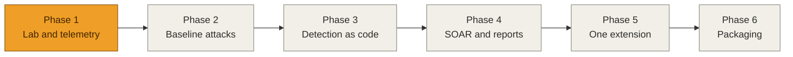
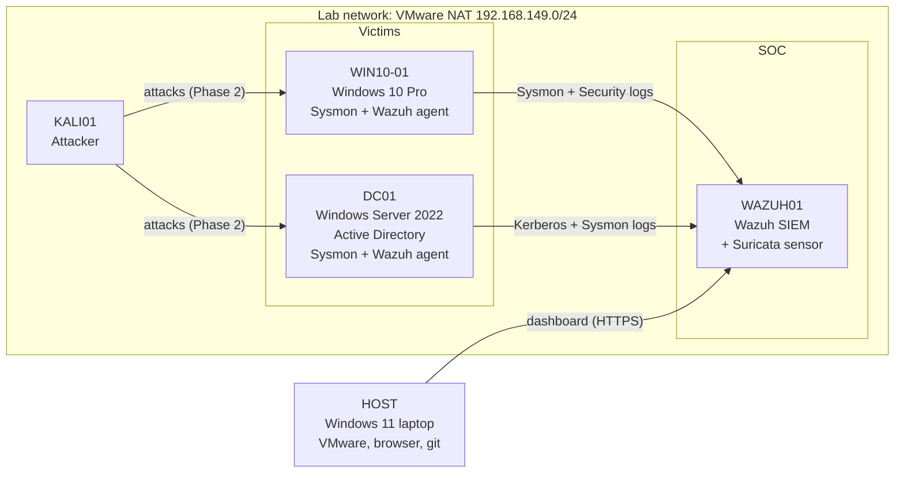
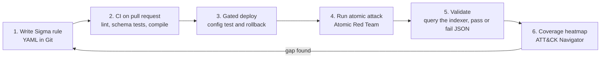

# Purple-Team SOC Lab: Detection as Code

A home SOC lab where detection rules are managed like software: written as code, tested, deployed to a SIEM, and proven against simulated attacks, with honest before/after detection numbers.

> **Lab disclaimer:** everything here runs in a virtual lab on one laptop against machines I own. Results come from simulated attacks, not production data, and make no claim about real-world detection rates.

## Why this project

Most SOC lab write-ups stop at "I installed a SIEM and took screenshots". This one aims to answer harder questions with evidence:

- Which attacker techniques does my SIEM detect out of the box, and which does it miss?
- When I write a rule, how do I know it works, and that it does not flood the analyst with false positives?
- Can detection rules be reviewed, tested and deployed like code?

## Status

| Phase | Goal | Status |
|---|---|---|
| 1. Lab and telemetry | Working lab, every log source verified in the SIEM | **Core done**, closeout in progress |
| 2. Baseline attacks | Frozen "before" measurement for 7+ ATT&CK techniques | Not started |
| 3. Detection as code | Sigma rules, CI, gated deploy, automated validation, before/after numbers | Not started |
| 4. SOAR and incident reports | Alert to case, 3-5 investigation write-ups | Not started |
| 5. One advanced extension | Cloud SIEM, DevSecOps gates, or measured LLM triage | Not started |
| 6. Packaging | Results, demo video, claims traced to evidence | Not started |



## Lab architecture



| Machine | Role | Runs |
|---|---|---|
| `HOST` | Operator workstation | VMware Workstation, browser, git |
| `WAZUH01` | SIEM and network sensor | Wazuh 4.14.10, Suricata 8.0.8 with ET Open rules |
| `DC01` | Domain controller | Active Directory `soclab.local`, DNS, Sysmon, Wazuh agent |
| `WIN10-01` | Domain-joined victim | Sysmon, Wazuh agent |
| `KALI01` | Attacker | Kali Linux |

More detail, including how a log becomes an alert and the planned Kerberoasting scenario, is in [docs/architecture.md](docs/architecture.md).

## The core idea: detection as code



Every rule is a file in Git. It is checked by CI, deployed through a gate, and validated by running the matching simulated attack and querying the SIEM for the resulting alert. A gap in coverage becomes the next rule to write. This loop is **planned for Phase 3**; the parts that exist today are the lab and the telemetry it relies on.

## What is verified so far

| Source | How it was verified |
|---|---|
| `WIN10-01` Sysmon and Security logs | Alerts from the Wazuh Sysmon and Windows rulesets appear in the dashboard |
| `DC01` Security log (Kerberos 4768, 4769, 4771, audit changes 4719) | Alerts for logons, audit failures and audit policy changes appear in the dashboard |
| `DC01` Sysmon | Sysmon alerts from `DC01` appear in the dashboard |
| Network (Suricata on `WAZUH01`) | A custom test rule fired for traffic between two other machines (`WIN10-01` and `DC01`) |

**A first finding:** Kerberos service ticket events (4769, the artifact of Kerberoasting) reach the SIEM, but the default ruleset only labels them as generic "Windows Logon Success". There is no dedicated detection, which is exactly what Phase 3 sets out to fix.

## Results

Filled in as each phase completes. Nothing below has been measured yet.

| Metric | Value |
|---|---|
| ATT&CK techniques simulated | TBD |
| Custom Sigma rules written | TBD |
| Detection rate before tuning | TBD |
| Detection rate after tuning | TBD |
| False-positive change | TBD |
| Incident reports | TBD |

The coverage table lives in [docs/attack-coverage-matrix.md](docs/attack-coverage-matrix.md).

## Technology

| Area | Tools |
|---|---|
| SIEM and EDR | Wazuh 4.14 (manager, indexer, dashboard) |
| Endpoint telemetry | Sysmon with the sysmon-modular configuration, Windows Security auditing |
| Network detection | Suricata with Emerging Threats Open rules |
| Identity | Active Directory, Kerberos auditing |
| Planned | Sigma, Atomic Red Team, GitHub Actions, ATT&CK Navigator, Shuffle and a case manager |
| Virtualization | VMware Workstation on a single 16 GB laptop |

## Repository layout

```
01-infrastructure/        Build notes and network diagram
02-attack-simulation/     Attack runbooks
03-detection-engineering/ Wazuh rules, Sigma rules, tuning notes
04-automation-soar/       SOAR workflows
05-incident-reports/      Investigation write-ups
docs/                     Architecture, lab conditions, coverage matrix, report template, roadmap
```

Key documents: [architecture](docs/architecture.md), [lab conditions](docs/lab-conditions.md), [roadmap](docs/ROADMAP.md), [incident report template](docs/incident-report-template.md).

## Known limits

- One laptop with 16 GB of RAM, so the lab is small (four virtual machines) and some components are deferred.
- No virtual machine snapshots, so a victim cannot be reverted to a clean state between runs.
- The lab network is VMware NAT. Attack runs will stop the VMware NAT service to cut internet access; this is documented in [lab conditions](docs/lab-conditions.md) and has to be verified before Phase 2.
- Results describe this lab only.

## License

MIT
