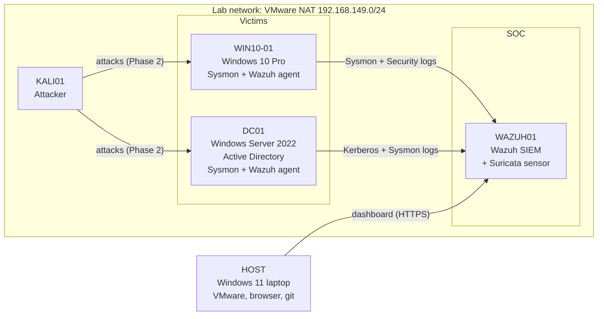
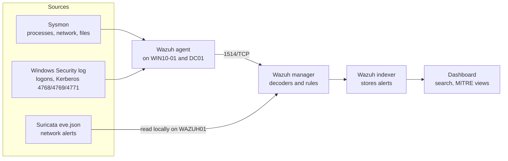
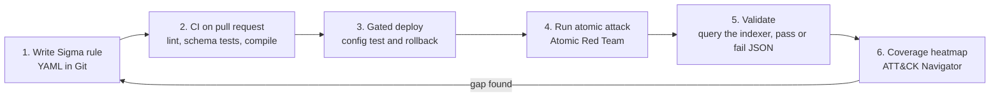
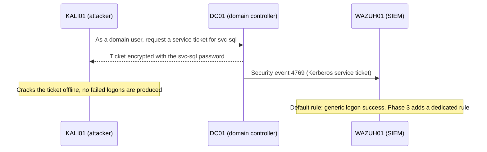
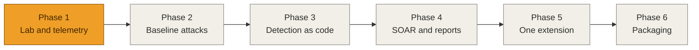

# Architecture

This page explains how the lab is built, how a log becomes an alert, and how detections are managed as code. All diagrams are Mermaid, so GitHub renders them directly.

Machine tags used everywhere in this repository: `HOST`, `WAZUH01`, `DC01`, `WIN10-01`, `KALI01` (and `SOAR01` in Phase 4).

## 1. Lab topology

| Machine | Role | Runs |
|---|---|---|
| `HOST` | Operator workstation | VMware Workstation, browser, git |
| `WAZUH01` | SIEM and network sensor | Wazuh 4.14.10 (manager, indexer, dashboard), Suricata 8.0.8 with ET Open rules |
| `DC01` | Domain controller | Active Directory `soclab.local`, DNS, Sysmon, Wazuh agent |
| `WIN10-01` | Victim workstation (domain-joined) | Sysmon, Wazuh agent |
| `KALI01` | Attacker | Kali Linux, Atomic Red Team runs target the victims |

Suricata sees traffic between other machines because the `WAZUH01` network card runs in promiscuous mode (verified with ICMP between `WIN10-01` and `DC01`).

## 2. How a log becomes an alert

An event only appears in the dashboard as an alert if a rule matches it. Events with no matching rule are collected but not shown. This is why Kerberos service tickets (event 4769) currently show up only as the generic "Windows Logon Success" rule, which is the detection gap Phase 3 closes.

## 3. The core idea: detection as code

Rules are files in Git, so every change is reviewed and testable. Each rule is validated against a real simulated attack, and the result feeds a before/after coverage number. Status: planned for Phase 3.

## 4. Planned attack scenario: Kerberoasting (T1558.003)

## 5. Roadmap

Amber means in progress, gray means not started. See the [README](../README.md) for the status table.
