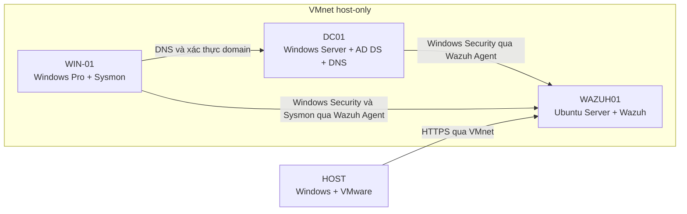

# Kiến trúc lab

## Topology

Các địa chỉ dưới đây là ví dụ. Nếu dải IP trùng subnet trên host, chọn một dải khác và ghi lại trong [Điều kiện lab](lab-conditions.md).

| Máy | Địa chỉ mẫu | Ghi chú |
|---|---|---|
| `HOST` | Adapter host-only do VMware gán | Dùng trình duyệt truy cập Dashboard |
| `WAZUH01` | `192.168.149.20/24` | Manager, Indexer, Dashboard cùng VM |
| `DC01` | `192.168.149.10/24` | AD DS và DNS của `soclab.local` |
| `WIN-01` | `192.168.149.30/24` | Trỏ DNS tới DC trước khi join domain |

## Từ event tới kết quả kiểm thử

1. Agent trên `DC01` và `WIN-01` gửi event về Wazuh Manager. Sysmon bổ sung ngữ cảnh tiến trình và hoạt động trên máy trạm.
2. Manager giải mã event và xét ruleset. Dashboard hiển thị các alert được đưa vào index. Dùng nguồn log gốc và khả năng lưu archive của Wazuh để kiểm tra riêng việc thu nhận event nếu cần.
3. Với ca live, đối chiếu nguồn log với alert theo máy, Event ID, tài khoản và thời gian. Với log mẫu, dùng bộ thử rule để kiểm tra kết quả khớp trên từng mẫu.
4. Dùng alert và log liên quan để dựng timeline. Đối chiếu tác nhân, tài khoản được cấp quyền, nhóm, phiên đăng nhập và bằng chứng thu hồi với phê duyệt của ca.

[Nhật ký event trong Wazuh](https://documentation.wazuh.com/current/user-manual/manager/event-logging.html) · [Kiểm thử decoder và rule](https://documentation.wazuh.com/current/user-manual/ruleset/testing.html)

Bắt đầu theo [Phase 01](phases/01-rebuild-lab.md). Mỗi lần đổi mạng, nguồn log hoặc bộ rule, cập nhật thông số thực tế để kết quả trước/sau có thể đối chiếu.
